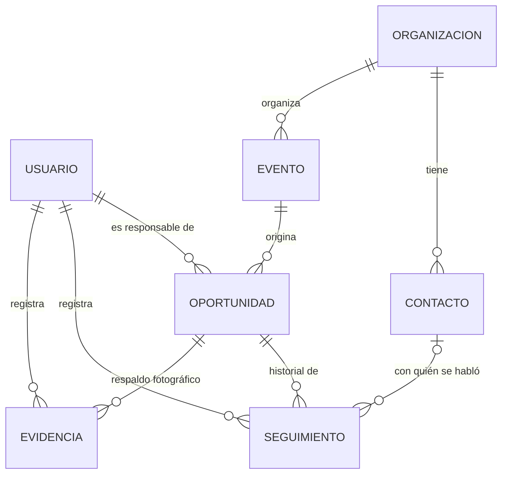

# Oportunidades Comerciales — App Android

Aplicación Android para que un equipo comercial identifique, gestione y dé seguimiento a **oportunidades de participación en eventos** (ferias, jornadas de beneficios, activaciones, actividades municipales, etc.). Funciona 100 % sin conexión, con datos locales y **completamente ficticios**.

> Evaluación 2 · Desarrollo de aplicaciones móviles

## Integrantes

| Integrante | Responsabilidad principal |
|---|---|
| _Nombre y apellido 1_ | _completar_ |
| _Nombre y apellido 2_ | _completar_ |

## Funcionalidades

**Dos roles con pantallas y permisos distintos**

| | Ejecutivo comercial | Supervisor comercial |
|---|---|---|
| Ver oportunidades | Solo las suyas | Todas |
| Crear oportunidad | Sí (queda a su nombre) | Sí (elige responsable) |
| Editar datos / registrar gestiones | Solo en las suyas | En todas |
| Cambiar prioridad | No | Sí |
| Asignar y reasignar responsable | No | Sí (panel **Equipo**) |
| Confirmar participación o descartar | **No** | Sí |
| Dashboard | Sus gestiones y eventos | Global + carga por ejecutivo + cola "En evaluación" |

**Pantallas** (14, conectadas por navegación): Login · Dashboard · Lista de oportunidades (búsqueda y filtros por estado y prioridad) · Detalle de oportunidad · Formulario de oportunidad (crear/editar) · Registro de gestión (seguimiento) · Eventos · Formulario de evento (con cámara) · Directorio de organizaciones · Detalle de organización · Formulario de organización · Formulario de contacto · Panel de equipo (supervisor) · Perfil.

**Flujo de estados.** Una oportunidad avanza por transiciones válidas (no se puede saltar etapas): _Evento identificado → Contacto pendiente → Contacto realizado → Propuesta enviada → En espera de respuesta → En evaluación → Participación confirmada → Activación realizada/cancelada → Cerrada_, con _Requiere seguimiento_ como desvío. Solo el supervisor confirma o descarta. Cada cambio de estado y cada reasignación queda en el historial.

**Recursos nativos**
- **Cámara** (y galería): se puede fotografiar el evento al crearlo y, desde el detalle de cualquier oportunidad, **agregar evidencias fotográficas**. Cada foto muestra una vista previa antes de guardarse (se puede descartar), lleva descripción opcional, fecha y autor, y queda asociada a la oportunidad en la tabla `evidencias`. Las imágenes se guardan en el almacenamiento interno de la app.
- **Calendario** del dispositivo: agenda el evento o un recordatorio de seguimiento (`ACTION_INSERT`; el usuario confirma o cancela y la app informa el resultado).

**Validaciones** (en `util/Validaciones.kt`, fuera de los Composables): obligatorios, largos, correo, teléfono, sitio web, números, fechas coherentes (término ≥ inicio, fecha límite ≤ evento, sin fechas pasadas), costos no negativos. Los mensajes aparecen bajo cada campo (`supportingText` + ícono de error) y los valores escritos se conservan. Las reglas de negocio y de permisos se **vuelven a comprobar en los repositorios**.

**Animaciones**: color de tarjeta animado (`animateColorAsState`) según prioridad y alertas, aparición/desaparición de errores, estados vacíos y campos condicionales (`AnimatedVisibility`), y reordenamiento de listas y tarjetas expandibles (`animateItem`, `animateContentSize`).

## Cuentas de prueba (ficticias)

| Rol | Correo | Contraseña |
|---|---|---|
| Ejecutivo | ana.ejecutiva@ejemplo.cl | Ana12345 |
| Ejecutivo | carlos.ejecutivo@ejemplo.cl | Carlos123 |
| Ejecutivo | diego.ejecutivo@ejemplo.cl | Diego1234 |
| Supervisor | sofia.supervisora@ejemplo.cl | Sofia1234 |

Los datos de demostración (5 organizaciones, 5 contactos, 5 eventos, 5 oportunidades y su historial) se cargan solo la primera vez que se abre la app, con fechas relativas a "hoy" para que siempre haya próximos, pendientes y atrasados. Las contraseñas se guardan como hash SHA-256.

## Arquitectura (MVVM)

```
UI (Compose)  →  ViewModel (StateFlow)  →  Repository  →  DAO (Room / SQLite)
 ui/*Screen        ui/*ViewModel            data/repository   data/local
```

- **UI**: Jetpack Compose + Material 3. Cada pantalla observa el `uiState` de su ViewModel con `collectAsStateWithLifecycle`.
- **ViewModel**: expone el estado como `StateFlow` y procesa las acciones del usuario.
- **Repository**: aplica permisos y reglas de negocio; ninguna pantalla puede saltárselas.
- **Fuente de datos**: Room con `BundledSQLiteDriver`.
- **Lógica pura y testeable** en `util/` (`Permisos`, `Validaciones`, `Dashboard`, `Filtros`, `Calendario`).
- **Tema** centralizado en `ui/theme`: colores y paleta en `Color.kt`, colores semánticos (éxito, advertencia, información, peligro y los estados/prioridades) en `ColoresSemanticos.kt`, tipografía en `Type.kt`. Las pantallas no usan colores hexadecimales.

### Modelo de datos



Siete tablas (`usuarios`, `organizaciones`, `contactos`, `eventos`, `oportunidades`, `seguimientos`, `evidencias`) con claves primarias autogeneradas, claves foráneas e índices. Está normalizado hasta 3FN: los datos del evento (fecha, lugar, público esperado, costo, foto) viven en `eventos`, los de la organización en `organizaciones`, y `oportunidades` solo guarda lo propio de la gestión comercial (estado, prioridad, responsable). Las pantallas que muestran datos combinados usan `JOIN` y no copias. Los seguimientos y las evidencias **nunca se borran** (`ON DELETE RESTRICT`): son el historial.

> La base de datos está en la **versión 2** (se agregó `evidencias`). Si ya habías instalado una versión anterior, desinstala la app o borra sus datos antes de ejecutar, para que se cree el esquema nuevo y se vuelvan a cargar los datos de demostración.

## Cómo ejecutar

1. Abrir la carpeta del proyecto con **Android Studio** (versión reciente) y dejar que Gradle sincronice.
2. Elegir un emulador o un teléfono con depuración USB (el nivel mínimo de Android es el definido en `app/build.gradle`).
3. Pulsar **Run ▶** e iniciar sesión con una cuenta de prueba.
4. Para reiniciar los datos de demostración: _Settings → Apps → Oportunidades Comerciales → Storage → Clear data_ (o desinstalar la app).

Si el emulador no tiene app de calendario o de cámara, la app lo informa con un mensaje en lugar de cerrarse.

**Pruebas unitarias**: `./gradlew test` (requiere `testImplementation("junit:junit:4.13.2")`). Cubren permisos y transiciones de estado, validaciones, cálculo del Dashboard y filtros.

## Estructura

```
app/src/main/java/com/example/appproyecto/
├── data/        model/ (entidades y enums) · local/ (Room, DAOs, datos demo) · repository/
├── ui/          login · dashboard · oportunidades · detalle · seguimiento · eventos
│                directorio · supervisor · perfil · navigation · componentes · theme
└── util/        Permisos · Validaciones · Dashboard · Filtros · Calendario · Fotos · Fechas
```

## Colaboración

Trabajo en GitHub con commits técnicos y descriptivos (por ejemplo `feat(directorio): formulario de contacto con validaciones`, `fix(permisos): ...`). El historial de commits muestra la participación de ambos integrantes.
